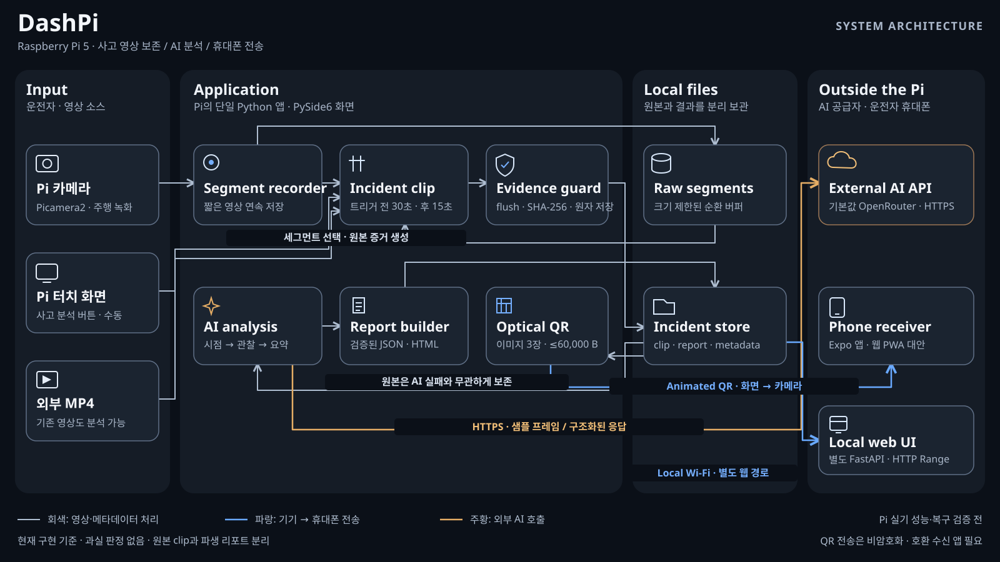
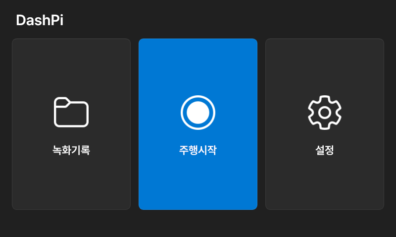
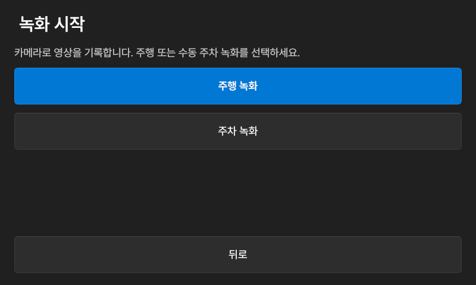
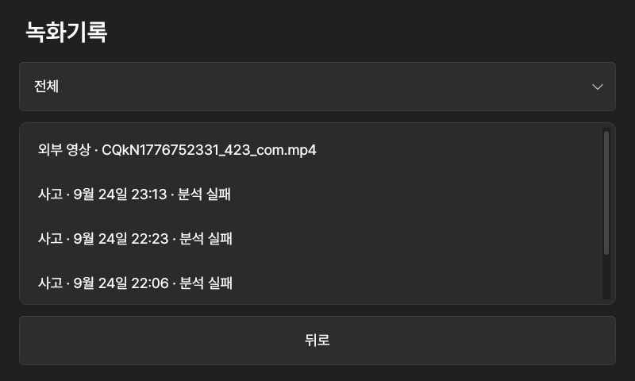
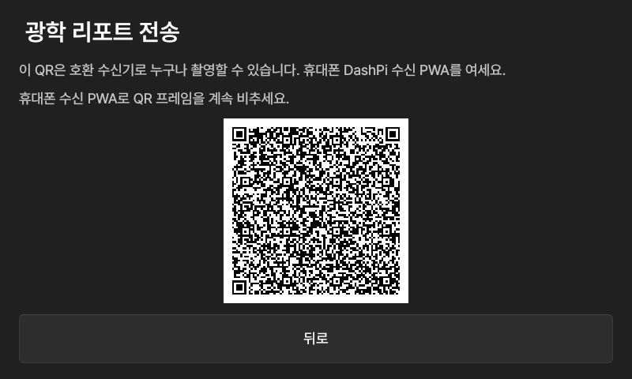
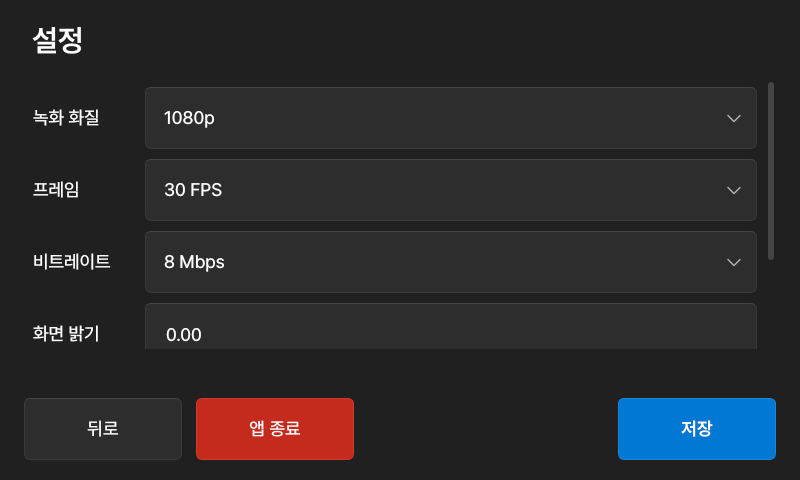

<p align="center">
  
</p>

<h1 align="center">DashPi</h1>

<p align="center">
  <strong>사고 영상은 먼저 지키고, AI 분석은 그다음에 합니다.</strong><br />
  Raspberry Pi에서 사고 구간을 보존하고, 장면을 정리한 리포트를 휴대폰으로 전하는 스마트 대시캠
</p>

<p align="center">
  <a href="#why">무엇을 해결하나요?</a> ·
  <a href="#status">현재 가능한 일</a> ·
  <a href="#start">직접 실행하기</a> ·
  <a href="#architecture">구조</a> ·
  <a href="#docs">문서 길잡이</a>
</p>

> **현재 구현 기준:** Pi용 PySide6 앱과 사고 처리·광학 QR 전송 코드는 구현되어 자동 테스트를 거쳤습니다. 휴대폰에는 Expo 수신 앱 1.2.2와 웹 수신기가 있습니다. Pi 5 카메라·LCD의 장시간 동작과 전원 차단 복구, Android 실기의 PDF 저장·공유는 아직 검증하지 않았습니다. AI 분석은 현재 외부 API 연결이 필요하며, 오프라인에서는 원본 영상을 보존하고 분석을 기다립니다.

<a id="why"></a>

## 무엇을 해결하나요?

사고 직후에는 영상을 남기는 일이 분석보다 먼저입니다. 인터넷이 끊기거나 AI가 실패하더라도 증거 영상이 없어지면 안 됩니다. DashPi는 사고 전후 구간을 **원본 clip으로 먼저 저장·검증**하고, 그다음 AI가 화면에 보이는 장면을 시간순으로 정리합니다.

운전자는 Pi 화면에서 사고를 표시하거나 보관된 MP4를 열어 분석할 수 있습니다. 완성된 리포트는 Pi에 남고, 애니메이션 QR로 휴대폰에 전달할 수 있습니다. **AI 리포트는 참고용 장면 정리이며 과실이나 법적 책임을 판정하지 않습니다.**

### 우리가 지키는 원칙

| 원칙 | 제품에 반영하는 방식 |
|---|---|
| **증거가 분석보다 먼저** | 사고 전 30초·후 15초의 `clip.mp4`를 저장하고 SHA-256으로 검증합니다. AI 실패는 유효한 clip을 지우지 않습니다. |
| **연결이 없어도 기록** | 녹화·clip 생성은 네트워크 없이 진행합니다. 외부 AI API가 닿지 않으면 `awaiting_analysis`로 남겨 재시도합니다. |
| **원본과 해석을 분리** | 원본 clip, 파생 영상, JSON·HTML 리포트와 휴대폰 전송용 자료를 따로 보관합니다. |
| **받은 파일도 검증** | QR 수신기는 복원한 파일의 길이와 SHA-256이 맞은 뒤에만 저장·열람을 허용합니다. |

### 운전자가 거치는 흐름

| 단계 | Pi에서 하는 일 | 휴대폰에서 하는 일 |
|---|---|---|
| **기록** | 카메라로 주행 영상을 녹화하거나 기존 MP4를 엽니다. | 필요하지 않습니다. |
| **사고 표시** | 화면의 **사고 분석**을 눌러 앞뒤 영상을 원본 clip으로 보존합니다. | 필요하지 않습니다. |
| **분석** | 연결되면 외부 AI API로 장면을 분석하고 리포트를 만듭니다. 연결이 없으면 기다립니다. | 필요하지 않습니다. |
| **전송·열람** | 검증된 리포트를 애니메이션 QR로 표시합니다. | DashPi 수신 앱으로 QR을 읽고 검증된 리포트를 저장·봅니다. |

이 표는 **현재 코드의 주요 흐름**입니다. 자동 충돌 감지, 물리 트리거, Pi의 핫스팟 자동 제어는 포함하지 않습니다.

<a id="status"></a>

## 지금 어디까지 만들었나요?

| 구분 | 현재 상태와 경계 |
|---|---|
| **Pi 앱 · 구현/자동 검증** | PySide6 홈·녹화·기록·설정·리포트·QR 화면과 Picamera2 연결 코드를 갖췄습니다. 실제 Pi 화면 캡처가 있지만, 카메라·LCD의 장시간 동시 동작과 성능은 수락 시험 전입니다. |
| **사고 보존 · 구현/자동 검증** | 세그먼트에서 사고 구간을 추출하고 `.partial` → flush → SHA-256 → 원자적 교체로 저장합니다. AI 분석 실패 후에도 clip을 보존합니다. |
| **AI·리포트 · 구현/자동 검증** | 기본 OpenRouter인 OpenAI 호환 API로 사고 시점 탐지 → 장면 관찰 → 요약을 수행합니다. 출력 형식을 검증하고 JSON·자급형 HTML 리포트를 만듭니다. 실제 사고 영상에서의 품질은 별도 검증이 필요합니다. |
| **QR 전송 · 구현/자동 검증** | 기본 전송은 사진 3장과 분석 결과를 담은 60,000바이트 이하 JSON입니다. 변환할 수 없으면 기존 HTML 전송을 시도합니다. 광학 프로토콜 한도는 16 MiB이며 QR은 암호화되지 않습니다. |
| **휴대폰 앱 · 구현/부분 검증** | Expo 수신 앱 1.2.2가 QR 복원·검증·리포트 열람·PDF 저장/공유 코드를 갖췄습니다. Node 테스트와 Android export는 확인했지만 실제 Android PDF 저장 선택창·공유는 미검증입니다. [1.2.2 기록](docs/releases/1.2.2.md) |
| **웹 경로 · 별도 프로토타입** | FastAPI가 사고 목록·리포트·HTTP Range 영상 응답을 제공하고, 웹 수신 PWA도 있습니다. Local Wi-Fi 서버와 핫스팟 제어는 Pi 앱에 통합되지 않았습니다. |
| **실기 수락 시험 필요** | Pi 5 프리뷰/녹화·타임스탬프, LCD 터치, QR 수신률, 발열·메모리·분석 지연, 갑작스러운 전원 차단 후 복구를 측정해야 합니다. |

완성된 소프트웨어 경로와 **실제 차량·휴대폰에서의 신뢰성**은 다릅니다. 코드·테스트·스크린샷을 실기 수락 시험의 대체 근거로 사용하지 않습니다. 현재 장치 구성은 Pi 5, 카메라, LCD이며 마이크·GPS·배터리 센서는 사용하지 않습니다.

<a id="start"></a>

## 직접 실행하기

**가장 빠른 확인은 PC에서 테스트 MP4와 가짜 분석기(`fake`)를 사용하는 방법**입니다. 이 경로에는 API 키가 필요하지 않습니다. Python 3.11 이상과 FFmpeg·ffprobe가 필요합니다. macOS에서는 `brew install ffmpeg`로 준비할 수 있습니다.

### 1. 설치

```sh
git clone https://github.com/jcmaker/DashPi.git
cd DashPi
python3 -m venv .venv
source .venv/bin/activate
python -m pip install -e ".[dev]"
```

### 2. 사고 처리 시뮬레이션

저장소 루트에 **45초 이상의 테스트 영상**을 `input.mp4`로 둔 뒤 실행합니다.

```sh
dashpi simulate input.mp4 --trigger-seconds 30 --data-root ./demo-data --ai-model fake
```

결과는 `demo-data/incidents/<incident_id>/`에 저장됩니다. `clip.mp4`는 원본 사고 구간, `annotated.mp4`는 파생 영상이며 `report.json`, `report.html`, `metadata.json`이 함께 생성됩니다. `fake` 결과는 동작 확인용이며 실제 AI 분석 품질을 보여 주지 않습니다.

### 3. 로컬 웹 프로토타입에서 보기

```sh
dashpi-server --data-root ./demo-data --host 127.0.0.1 --port 8000
```

브라우저에서 <http://127.0.0.1:8000/>을 엽니다. 이 서버는 **별도 로컬 프로토타입**이며 공용 인터넷에 직접 노출하는 운영 모드가 아닙니다.

<details>
<summary><strong>Raspberry Pi 5에서 네이티브 앱 실행</strong> · 실기 수락 시험 전</summary>

Raspberry Pi OS Desktop 64-bit, Pi 카메라 모듈과 LCD가 필요합니다. Picamera2/OpenCV는 Pi OS 패키지를 쓰고, 가상환경에서 시스템 패키지가 보이게 합니다.

```sh
sudo apt update
sudo apt install python3-venv python3-picamera2 python3-opencv ffmpeg
python3 -m venv --system-site-packages .venv
source .venv/bin/activate
python -m pip install --no-deps -e .
python -m pip install 'fastapi>=0.116,<1' 'uvicorn>=0.35,<1' 'PySide6>=6.7,<7' 'qrcode>=8,<9'
python -c 'from picamera2 import Picamera2; from picamera2.encoders import LibavH264Encoder; from picamera2.outputs import PyavOutput, SplittableOutput; from picamera2.previews.qt import QGlSide6Picamera2; import cv2'
dashpi-install-desktop
mkdir -p ~/.config/dashpi && cp ai.env.example ~/.config/dashpi/ai.env && chmod 600 ~/.config/dashpi/ai.env
dashpi-app
```

실제 AI 분석에는 `~/.config/dashpi/ai.env`의 `DASHPI_AI_API_KEY`가 필요합니다. 기본 API 주소는 `ai.env.example`에서 확인할 수 있습니다. 녹화는 자동으로 시작하지 않습니다. 앱에서 **주행시작 → 주행/주차 선택 → 사고 분석**을 누릅니다. 기존 MP4는 Pi의 `~/Videos`에 넣고 **녹화기록 → 전체**에서 열 수 있습니다.

Pi 5에는 H.264 하드웨어 인코더가 없어 소프트웨어 인코더를 사용합니다. 실기에서 부담이 크면 설정에서 720p/24 FPS로 낮춰 측정해야 합니다. `dashpi-install-desktop`은 앱 메뉴와 바탕화면 바로가기를 설치합니다.

</details>

<details>
<summary><strong>휴대폰 수신 앱 개발 빌드</strong> · Android</summary>

Android 개발 환경과 기기를 준비한 뒤 저장소 루트에서 실행합니다. 카메라 원시 프레임을 읽는 네이티브 모듈을 사용하므로 Expo Go 대신 개발 빌드가 필요합니다.

```sh
cd receiver-native
npm ci
npx expo run:android
```

실제 기기에서 QR 수신률과 PDF 저장·공유까지 확인해야 합니다.

</details>

<details>
<summary><strong>실행이 막혔나요?</strong> 영상 · AI · QR 확인</summary>

- **영상 처리 실패:** `ffmpeg`와 `ffprobe`가 설치되어 있는지, 입력 영상이 45초 이상인지 확인합니다.
- **AI가 분석 대기:** 네트워크와 `DASHPI_AI_API_KEY`를 확인합니다. `fake` 시뮬레이션은 키 없이 실행됩니다.
- **QR을 못 읽음:** 일반 카메라 앱 대신 호환 DashPi 수신 앱을 사용합니다. 웹 PWA는 사용 전에 온라인에서 설치해야 합니다. 실제 LCD 밝기·QR 크기·수신 속도는 실기 보정 대상입니다.
- **QR 파일이 너무 큼:** 16 MiB를 넘으면 Pi 앱이 전송 불가를 알리고 로컬 리포트를 보존합니다. Local Wi-Fi로 자동 전환하지 않습니다.

</details>

<a id="architecture"></a>

## 어떻게 구성했나요?



**현재 구현 구조**입니다. Pi의 네이티브 앱이 녹화와 사고 처리, 원본 보존, AI 요청, 리포트 생성, QR 송신을 맡습니다. 실제 파일은 Pi에 남고, AI 요청에는 추출한 장면 프레임이 외부 공급자에게 전달됩니다. 원본 전체 영상을 클라우드에 보관하는 기능은 없습니다.

- **사고 보존:** 화면 트리거 또는 기존 MP4 재생 위치 → 전후 구간 clip 생성 → SHA-256과 metadata 기록. AI가 실패해도 이 파일을 보존합니다.
- **AI 분석:** 기본 외부 API에 샘플 프레임을 보내 사고 시점·관찰·요약을 받습니다. 응답을 검증한 뒤 리포트를 만듭니다. 네트워크 오류에는 분석 대기와 재시도가 있습니다.
- **휴대폰 전송:** Pi는 검증된 전송용 리포트를 애니메이션 QR로 표시합니다. Expo 수신 앱은 파일 길이·digest를 확인한 뒤 저장·열람합니다. 웹 수신 PWA도 별도 구현되어 있습니다.
- **Local Wi-Fi:** FastAPI·HTTP Range로 전체 영상과 리포트를 조회하는 기존 웹 프로토타입입니다. Pi 앱이 핫스팟을 켜거나 QR 실패 시 자동으로 전환하지 않습니다.

[SVG 크게 보기](docs/assets/dashpi-system-architecture.svg) · [AI 분석 설계](docs/superpowers/specs/2026-09-25-openrouter-ai-analysis-design.md) · [광학 전송 설계](docs/superpowers/specs/2026-09-02-offline-transfer-design.md)

### 실제 화면

아래 Pi 화면은 800×480 네이티브 앱을 실제 Pi에서 캡처했습니다. QR 화면에는 데모 리포트를 사용했습니다. 화면 캡처만으로 장시간 녹화·전원 차단 복구가 검증된 것은 아닙니다.

| 홈 | 녹화 시작 | 녹화기록 |
|---|---|---|
|  |  |  |

| QR 전송 | 설정 |
|---|---|
|  |  |

### 저장·전송의 경계

`<data-root>/incidents/<incident_id>/`에는 `clip.mp4`와 파생 영상·리포트가 분리되어 저장됩니다. API는 파일 경로·크기·digest를 metadata와 대조하고, QR 수신기도 전체 길이와 SHA-256을 확인합니다. **QR은 암호화되지 않아 주변 카메라가 촬영할 수 있습니다.** 민감한 장면은 전송 환경을 확인해야 합니다.

<details>
<summary><strong>개발 검증 명령</strong> Python · 웹 · 휴대폰 수신 앱</summary>

```sh
python -m pytest -q
npm ci --prefix web
npm test --prefix web
npm run build --prefix web
npm ci --prefix receiver-native
npm test --prefix receiver-native
```

Python 테스트는 사고 구간, AI 실패 후 clip 보존, 파일 무결성, API 접근을 확인합니다. 웹 테스트는 광학 프레임 손실·중복·순서 변경과 Python/TypeScript 호환을 확인합니다. 휴대폰 수신 앱의 Node 테스트는 Android·iOS 실기 검증을 대신하지 않습니다.

</details>

<a id="docs"></a>

## 문서 길잡이

| 알고 싶은 것 | 먼저 읽을 곳 | 담긴 내용 |
|---|---|---|
| **제품의 목표는?** | [PRD](docs/PRD.md) | 초기 제품 목표. 로컬 Ollama와 네이티브 앱 제외 등 과거 범위가 남아 있으므로 현재 구현 상태는 이 README와 코드 기준으로 확인합니다. |
| **기술 경계는?** | [TRD](docs/TRD.md) · [AI 분석 설계](docs/superpowers/specs/2026-09-25-openrouter-ai-analysis-design.md) | 사고 처리·전송 요구와 외부 AI API로의 변경 배경 |
| **광학 QR의 설계는?** | [광학 전송 설계](docs/superpowers/specs/2026-09-02-offline-transfer-design.md) | [Decimen Optical Transfer](https://github.com/bashalarmistalt/decimen-optical-transfer)의 LT 방식에서 착안한 독자 규격과 수신 검증 |
| **앱에서 무엇이 달라졌나?** | [앱 1.2.2 릴리스 기록](docs/releases/1.2.2.md) | 이미지 리포트의 PDF 저장·공유, 자동 검증과 실기 미검증 범위 |
| **코드는 어디에 있나?** | [`src/dashpi/`](src/dashpi/) · [`receiver-native/`](receiver-native/) · [`web/`](web/) | Pi 앱·사고 처리, Expo 수신 앱, 광학 전송 웹 코드 |
| **어떻게 검증하나?** | [`tests/`](tests/) · [`receiver-native/tests/`](receiver-native/tests/) | Python 파이프라인과 휴대폰 수신기 테스트 |

README는 프로젝트의 입구입니다. 오래된 설계 문서의 **목표**와 현재 코드의 **구현 상태**가 다르면 위 상태 표와 실제 코드를 먼저 확인해 주세요.

---

**라이선스** · 저장소 전체에 적용되는 `LICENSE`는 아직 없습니다. 별도 허락이나 라이선스가 추가되기 전에는 소스 코드 사용·수정·재배포 권한이 자동으로 부여되지 않습니다.
