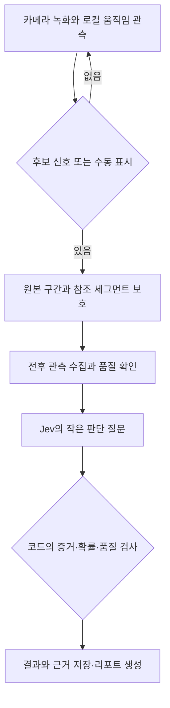

# DashPi 사고 감지 및 의사결정 설계 초안

작성일: 2026-10-30  
상태: 제안. 이 문서는 구현 완료나 성능 검증을 뜻하지 않는다.  
조사 기준: `main` 커밋 `58fbf07909f2500354c65b4a9034b99fda2049e3`

## 1. 먼저 답해야 할 질문

**DashPi는 무엇을 근거로 사고가 발생했다고 판단하는가?**

촬영 중 주변 객체와 카메라의 움직임을 관측하고, 이상 변화가 발생한 구간을 먼저 보존한다. 그 구간에서 접촉 정황, 직후 궤적 변화, 영상 품질과 누락 정보를 수집한다. 의사결정 모델 Jev는 이 관측 정보와 명시적인 기준을 받아 충돌을 뒷받침하는지 평가한다. 프로그램은 증거와 검증된 임계값을 함께 확인해 `충돌 정황 있음`, `충돌 관측 없음`, `판단 불가`로 처리한다.

움직임 검출은 사고 구간을 찾는 출발점이다. 움직임이 크다는 이유만으로 사고라고 판단하지 않는다. Jev라는 모델 이름, 출력 타입의 정확성, 높은 모델 확률도 물리적인 충돌을 증명하지 않는다.

## 2. 현재 코드에서 확인한 사실

| 코드 | 현재 동작 | 사고 감지 관점의 한계 |
|---|---|---|
| [DeviceSession](../../../src/dashpi/device_session.py) | 사용자가 화면에서 트리거하면 전후 구간을 보존한다. | 실시간 자동 충돌 감지기는 없다. |
| [analysis.locate](../../../src/dashpi/analysis.py) | 표본 프레임에서 충돌·급정거·급회피 순간의 시각을 묻는다. | 서로 다른 사건을 묶고, `사고 없음`과 `판단 불가`를 표현하지 못한다. |
| `LOCATE_SCHEMA` | `incident_timestamp`, `confidence`, `reason`을 요구한다. | 사건이 없어도 시각을 선택하게 만드는 구조다. |
| [vision.draw_overlays](../../../src/dashpi/vision.py) | 가장 큰 도로 이용자 박스를 빨간색으로 표시한다. | 빨간색은 충돌·위험 점수가 아니다. |
| `assign_track_ids` | 같은 클래스의 이전 박스와 IoU로 ID를 연결한다. | ByteTrack 구현이 아니며, 가림·급이동 때 ID 연속성을 검증해야 한다. |
| [IncidentPipeline](../../../src/dashpi/pipeline.py) | 원본 보존과 AI 분석 이후 선택적으로 박스·궤적 관측을 생성한다. | 현재 객체 관측은 앞선 AI 판단의 입력이 아니다. |
| [평가 도구](../../../src/dashpi/evaluation.py) | 지정된 사고 시각과 관찰·요약 품질을 비교한다. | 정상 주행의 오탐, 사건 없는 영상, 연속 감지 지연을 평가하는 체계는 아니다. |

현재 장비 기준은 Pi 5, 카메라, LCD다. IMU·GPS·마이크를 이미 설치한 것처럼 기술하지 않는다. 기존 문서의 로컬 Ollama·클라우드 금지·핫스팟 관련 과거 설명과 충돌하면 최신 README, 실제 코드, 2026-09-25 외부 API 분석 설계를 함께 확인한다.

## 3. 범위와 사건 정의

초기 검증 대상은 **촬영 차량과 차량·물체 사이의 충돌 정황 감지**로 제안한다. 이 범위는 작성자의 제안이며 사용자 확정 사항은 아니다. 주변 차량끼리의 사고, 전복, 비접촉 사고, 보행자 사고의 성능은 별도로 평가한다.

물리적 충돌은 물체 간 실제 접촉 사건이다. 화면의 박스 중첩은 실제 접촉과 같지 않다. 화면 밖 후방 충돌이나 가림으로 접촉을 볼 수 없는 경우 카메라만으로 확정할 수 없으며, 급접근·정지·흔들림만으로 충돌을 단정하지 않는다.

| 구분 | 정의 | 출력 원칙 |
|---|---|---|
| 위험 | 급접근이나 경로 충돌 가능성이 관측됨 | 사고 발생과 분리해 기록 |
| 충돌 정황 있음 | 명시된 증거 기준으로 실제 접촉을 뒷받침함 | 후보 시점·근거·관측 한계를 함께 표시 |
| 충돌 관측 없음 | 충분히 관측한 구간에서 충돌 증거를 찾지 못함 | 차량 전체에 사고가 없었다는 뜻으로 확장 금지 |
| 판단 불가 | 시야·표본·객체 추적·시간 동기화가 부족하거나 증거가 모순됨 | 추가 관측 또는 사용자 검토로 연결 |

법적 책임, 과실 비율, 영상만으로 확인할 수 없는 실제 속도는 판정하지 않는다.

## 4. 접근 방법과 선택 이유

| 방법 | 장점 | 비용과 한계 |
|---|---|---|
| 기존 비전 모델에 사고 여부까지 한 번에 질문 | 현재 분석 경로를 빠르게 활용 | 관측·판단·설명이 섞여 오류의 원인을 분리하기 어려움 |
| 로컬 움직임 관측 + 비전 관찰 + Jev 판단 + 코드 정책 | 관측 근거와 의사결정 기준을 각각 시험 가능 | 관측 계약·Jev 연동·평가 데이터가 필요 |
| Jev 실험 이미지 기능으로 프레임 직접 판정 | 별도 관찰기를 줄일 가능성 | 이미지 기능은 제공사가 프로토타입용으로 명시. 영상 이해 성능도 별도 검증 필요 |

**작성자 제안은 두 번째 방법이다.** 현재 원본 보존·외부 비전 분석·리포트 생성 경로를 활용하면서 판단 근거를 명시할 수 있기 때문이다. Jev는 필수 성능 우위가 입증된 구성 요소가 아니라 비교 실험 대상이다. 동일 관측 정보에 대한 규칙 기반 판단 및 기존 비전 모델과 비교한다.

현재 Jev 문서는 영상·오디오 직접 입력을 지원하지 않는다고 설명한다. 이미지 입력은 별도 실험 기능이다. Jev는 고객별 파인튜닝 대신 `state`, 질문의 `instructions`, `criteria`로 분야별 맥락을 전달한다. 이 설계는 영상에서 추출한 구조화 관측을 Jev에 전달하는 경로를 기본으로 한다. [모델 문서](https://docs.typesafe.ai/models) · [이미지 기능](https://docs.typesafe.ai/images)

## 5. 제안 처리 흐름



### 5.1 촬영 중 후보 찾기

1. 녹화와 별도 작업자로 저해상도 프레임의 움직임을 관측한다. 녹화 작업은 AI API 응답을 기다리지 않는다.
2. 전역 영상 움직임, 지속 추적된 객체의 화면상 크기·방향 변화로 후보 구간을 찾는다. 광학 흐름이나 객체 검출기의 구체적 선택과 처리 주기는 Pi 실측으로 결정한다.
3. 카메라 이동·회전·노출 변화와 객체 움직임을 구분할 수 없는 경우 품질 부족을 기록한다. 이런 경우에도 후보 보존은 가능하지만 충돌 확정 근거로 사용하지 않는다.
4. 후보를 발견한 즉시 참조하는 원본 세그먼트를 보호한다. 마지막 판정을 기다리다 순환 녹화에서 지워지지 않게 한다. 기존 수동 트리거와 동일한 보존 경로를 사용하고 중복 후보는 병합한다.
5. 네트워크가 없거나 Jev 요청이 실패해도 보존을 계속한다. 로컬 후보 기록과 재시도 상태를 남긴다.

후보 검출 임계값은 검증 데이터로 정한다. 큰 움직임, 박스 중첩, 빨간 박스 중 하나만으로 사고 상태로 전환하지 않는다. 연속 정상 주행에 후보가 없다고 사고 감지 성공을 주장하지 않는다.

### 5.2 후보 구간의 관측

원본 clip의 시간축을 기준으로 접근 전, 접촉 의심 시점, 이후 움직임을 비교한다. 기존 12장 균등 표본은 짧은 접촉 순간을 놓칠 수 있으므로 후보 전후 고밀도 관측과 전체 구간 관측을 함께 시험한다. 관측되지 않은 접촉은 `없음` 대신 `알 수 없음`으로 기록한다.

객체 검출·추적과 영상 관찰은 Jev 호출보다 먼저 수행해야 한다. 현재처럼 박스 관측을 리포트 생성 뒤에 만드는 순서로는 Jev가 그 정보를 판단 근거로 사용할 수 없다.

### 5.3 Jev가 평가할 질문

질문마다 확인할 근거와 금지할 추론을 제공한다. Jev가 관측하지 않은 접촉을 만들거나, 입력에 이미 적힌 `사고=true`를 되읽는 구조로 만들지 않는다.

| 질문 | 필요한 관측 | 판단 기준 |
|---|---|---|
| 실제 접촉을 뒷받침하는 시각적 증거가 있는가? | 접촉 부근 프레임과 독립 관찰자의 근거 | 박스 중첩·급접근만으로 긍정하지 않음 |
| 접촉 의심 시점 직후 움직임의 불연속이 있는가? | 시간순 궤적·방향·자세와 추적 품질 | 가림·ID 변경·카메라 회전에 의한 변화와 구분 |
| 노면 충격·급제동 등 다른 설명이 가능한가? | 도로와 전후 움직임 관측 | 방지턱이 보이지 않는다고 방지턱을 배제하지 않음 |
| 현재 자료로 사건을 구분할 수 있는가? | 시야, 표본 간격, 블러, 추적 실패, 누락 필드 | 근거가 부족하거나 모순이면 판단 불가 |

각 질문은 `예`, `아니오`, `판단 불가`를 담은 Choice로 표현하는 방안을 기본으로 한다. 질문들은 같은 입력을 독립 평가하므로 같은 호출 안에서 앞 질문의 답을 다음 질문이 읽는다고 가정하지 않는다. 결과 조합은 코드에서 수행한다. [공식 질문 설계 안내](https://docs.typesafe.ai/introduction)

### 5.4 프로그램의 최종 처리

| 조건 | 처리 |
|---|---|
| 후보 신호만 있음 | 영상 보존. 사고라고 표시하지 않음 |
| 관측 품질이 충분하고, 접촉 증거와 일치하는 직후 움직임 변화가 있으며, 검증된 판단 정책을 통과 | `collision_supported`: 충돌 정황 있음 |
| 접촉 예상 부위와 전후 구간을 충분히 관측했으나 접촉 증거가 없고, 급제동·회피·노면 충격 등의 관측 설명과 일치 | `no_collision_observed`: 해당 구간에서 충돌 관측 없음 |
| 가림·화면 밖·추적 실패·표본 누락으로 접촉 여부를 관측할 수 없거나, 답이 상충하거나 판단 점수가 낮음 | `uncertain`: 판단 불가 |
| API 실패·응답 검증 실패 | `pending` 또는 `error`. 의미상 판단 불가와 구분 |

실행 오류를 먼저 처리하고, 이어서 품질 부족·증거 모순을 검사한다. 이 검사를 통과한 관측에만 긍정·부정 판정을 적용한다. `보았지만 접촉 증거가 없음`과 `볼 수 없어 접촉 여부를 모름`을 구분한다.

위 정책은 초기 보수적 기준이다. 센서 없는 화면 밖 충돌이나 경미 접촉은 놓치거나 판단 불가가 될 수 있다. 이를 성능 한계로 집계한다. 후속 IMU가 추가되더라도 충격 단독으로 충돌을 확정하지 않는다.

임계값은 미정이다. `0.8이면 사고`처럼 검증 전 기본값을 정하지 않는다. Jev의 `confidence`는 응답 확률 분포에서 계산한 수치이며 별도의 물리적 증거가 아니다. 여러 질문·반복 프레임의 확률은 서로 독립이 아니므로 곱해서 확신을 부풀리지 않는다. [확률과 confidence](https://docs.typesafe.ai/confidence)

## 6. 관측·판단 데이터 계약 제안

다음은 구현 API가 아니라 설계용 예시다. `null`과 누락 사유를 유지하고 센서가 없다는 이유로 측정값을 0으로 넣지 않는다.

```json
{
  "schema_version": "incident-observation-v1",
  "candidate_id": "candidate-demo-001",
  "clip_sha256": "<verified-clip-digest>",
  "timebase": "clip_seconds",
  "window": {"start": 0.0, "end": 8.0},
  "candidate_sources": ["visual_motion"],
  "quality": {
    "contact_region_visible": "unknown",
    "tracking_continuity": "poor",
    "sampling_coverage": "partial"
  },
  "evidence": [
    {
      "id": "obs-001",
      "source": "object_tracker",
      "start": 3.8,
      "end": 4.1,
      "kind": "bbox_area_ratio",
      "value": 1.4,
      "frame_refs": ["frame-0038", "frame-0041"]
    },
    {
      "id": "obs-002",
      "source": "visual_observer",
      "start": 4.1,
      "end": 4.3,
      "kind": "contact_visibility",
      "value": "occluded",
      "frame_refs": ["frame-0041", "frame-0043"]
    }
  ],
  "optional_sensors": {
    "imu": {"available": false, "samples": null}
  }
}
```

이 입력의 기대 처리는 `uncertain`이다. 박스 크기 변화는 관측값이고 실제 거리·속도·접촉 판정이 아니다. 예시 숫자는 충돌 임계값이 아니다.

판단 결과에는 다음을 별도로 저장한다.

- 실행 상태: `pending`, `complete`, `error`.
- 사건 결과: `collision_supported`, `no_collision_observed`, `uncertain`. 실행 미완료이면 `null`.
- 후보 시간 범위와 근거 관측 ID. 단일 시점을 모르면 시각을 강제로 채우지 않는다.
- Jev 질문별 원 응답, 확률, 모델 버전, 질문 버전, 정책 버전, 입력 digest, 호출 지연.
- 확정하지 못한 이유, 관측 범위, 누락 정보. 파생 근거 ID는 원본 입력에 존재하는지 코드에서 검증한다.

기존 `IncidentState`는 파일 처리 상태이고, 위 사건 결과는 의미 판단이다. `READY`는 리포트가 준비됐다는 뜻이며 충돌이 확정됐다는 뜻으로 재사용하지 않는다. 기존 수신기와 리포트 스키마를 즉시 바꾸지 않고, 별도 판단 기록을 먼저 저장하는 방안을 제안한다.

## 7. 원본 보존·오류 처리

- 후보 발생 시 원본부터 보호한다. Jev의 부정 응답이나 판단 불가 결과로 보존된 clip을 자동 삭제하지 않는다.
- 오프라인에서도 녹화·수동 트리거·후보 원본 보호를 유지한다. 외부 비전과 Jev 판단은 연결 후 수행한다. 완전 오프라인 AI 판단이라고 소개하지 않는다.
- 재시도는 동일 후보 ID와 입력 digest로 묶고, 중복 요청으로 사건을 늘리지 않는다. 속도 제한·예산·대기열 상한은 기록 작업과 분리한다.
- API 실패를 `충돌 없음`으로 변환하지 않는다. 재시도 한도 초과는 오류 기록과 사용자 확인 대상으로 남긴다.
- 모델이 선택지 밖 값을 반환하지 않는다는 성질은 판단이 항상 사실이라는 보장이 아니다.

## 8. 검증 설계

성공 기준은 **사건 존재 여부**, **시각**, **오탐**, **판단 보류**, **원본 보존**을 함께 측정하는 것이다. 기존처럼 사건이 있는 clip의 시각 오차만 비교해서는 부족하다.

| 데이터 | 확인할 실패 |
|---|---|
| 정상 주행·정차·주차 | 사건 없는 영상에서 충돌을 만들어 내는가 |
| 방지턱·포트홀·카메라 흔들림·노출 급변 | 큰 영상 변화에 오탐하는가 |
| 급제동·급회피·근접 통과 | 위험을 실제 충돌과 혼동하는가 |
| 확인 가능한 충돌 | 후보 생성 또는 판단 단계에서 누락하는가 |
| 가림·야간·영상 누락·화면 밖 사건 | 알 수 없는 것을 단정하는가 |
| 네트워크 장애·느린 API·저장 공간 압박 | 녹화와 원본 보호를 방해하는가 |

정답은 독립 검토자가 원본을 보고 붙인다. 충돌 사건의 존재, 촬영 차량 관련 여부, 시간 범위, 시각 증거의 충분성을 분리해 기록한다. 촬영 영상만으로 실제 충돌을 확인할 수 없으면 별도 실험 기록이 없는 한 정답도 불명으로 둔다. 동일 주행의 인접 프레임이나 재인코딩본을 학습·기준 조정·최종 시험에 나누어 넣지 않는다.

측정 항목:

- 후보 검출 재현율과 최종 충돌 재현율을 각각 계산한다. 판단 불가로 남긴 실제 충돌도 자동 판정 성공으로 계산하지 않는다.
- 연속 정상 주행 시간당 잘못 보존한 후보 수와 잘못 표시한 충돌 수를 각각 계산한다.
- 접촉 시점에서 후보 생성·원본 보호·최종 판단까지의 지연을 구분한다.
- 판단 불가 비율, 그중 실제 충돌 비율, 자동 처리한 사건의 정확도를 함께 보고한다.
- 확률 구간별 실제 정답률을 비교해 DashPi 데이터에서의 보정 상태를 확인한다.
- Pi의 녹화 누락·프레임 지연·CPU·메모리·온도와 네트워크/관측/API 지연을 따로 측정한다.
- Jev와 규칙 기반 및 기존 모델을 동일 관측 입력으로 비교한다. 요약문이 자연스럽다는 이유로 감지 성능이 높다고 평가하지 않는다.

목표 수치와 임계값은 초기 데이터의 기준선 측정 후 정한다. 정량 수락 기준을 정하고 별도 시험 세트를 통과하기 전까지 자동 사고 감지를 검증 완료로 표시하지 않는다. 고카트·합성 영상의 결과를 실제 자동차의 성능으로 일반화하지 않는다.

## 9. 구현 시 변경할 부분과 순서

1. **정의와 평가부터:** 사건 결과·판단 보류·사건 없는 영상의 정답 형식을 정의하고, 평가기를 확장한다.
2. **저장 영상 실험:** 현재 `analysis.py`에서 사고 존재 여부와 시점 선택을 분리한다. 사건이 없거나 불명일 때 강제 시각을 생성하지 않는다. 여러 사건이 있는 영상은 후보 구간별로 평가한다.
3. **관측 순서 변경:** 선택적 객체 관측과 비전 관찰을 의사결정보다 앞에 배치한다. 기존 대형 객체 강조색은 사고 표시로 사용하지 않는다.
4. **Jev 비교 연동:** 기존 OpenAI 호환 ChatClient와 구분된 클라이언트·설정·질문 버전을 만든다. 실제 키 없이 모의 응답으로 재시도·응답 검증을 시험하고, 승인된 실험 예산 안에서 실 API를 비교한다.
5. **연속 녹화 후보 연결:** 저장 영상에서 기준선을 확보한 뒤 로컬 후보 발생을 `DeviceSession`의 기존 보호·병합 경로에 연결한다. 카메라 단일 소유와 녹화 우선 원칙을 유지한다.
6. **실기 수락 시험:** 정상 장시간 주행, 고카트 시험, 장애 복구를 구분해 시험한다. 원본 보존이 확인된 뒤에 자동 표시 범위를 넓힌다.

이번 변경은 설계 문서와 README의 안내만 추가한다. 위 단계의 제품 코드·SDK·실 API 호출·센서 연동은 구현하지 않는다. 관측기 선택, 처리 주기, 대기열 상한은 구현자가 장비 측정을 바탕으로 제안하되, 사용자가 확정한 것처럼 기록하지 않는다.

## 10. 발표에서 사용할 설명

> DashPi의 현재 구현은 사용자가 표시한 구간을 보존하고 AI가 장면을 정리합니다. 확장 설계에서는 촬영 중 객체와 카메라의 움직임을 관측해 의심 구간을 먼저 보존합니다. 이후 접촉 정황과 직후 움직임 변화, 관측 품질을 Jev 의사결정 모델로 평가합니다. 근거가 부족하면 판단 불가로 남기며, 정상 주행의 오탐과 실제 충돌의 누락을 측정해 기준을 조정합니다. 자동 감지 성능은 아직 검증 전입니다.

## 참고 자료

- [TypeSafe: Introducing System One Models & Jev](https://typesafe.ai/blog/introducing-system-one-models-and-jev)
- [TypeSafe: 질문과 구조화 의사결정](https://docs.typesafe.ai/introduction)
- [TypeSafe: 모델 입력과 분야별 기준 전달](https://docs.typesafe.ai/models)
- [TypeSafe: 실험 이미지 입력](https://docs.typesafe.ai/images)
- [TypeSafe: 확률과 confidence](https://docs.typesafe.ai/confidence)
- [DoTA: 미래 객체 위치 예측을 이용한 교통 이상 탐지 연구](https://iucvl.github.io/paperhtmls/dota2022pami.html)

DoTA는 교통 이상 탐지 접근의 참고 자료다. 해당 연구 결과가 DashPi 또는 Jev의 사고 감지 성능을 보증하지 않는다.
